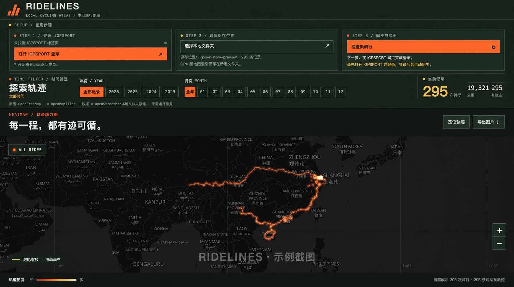

# RIDELINES · 本地骑行地图

一个桌面 Chrome 扩展：读取你已登录的 iGPSPORT 网页中的户外骑行记录，把 GPX 和地图索引保存在你选择的本地文件夹，并按年份、月份绘制轨迹热力图。不需要 Node.js、账号服务器或云端数据库。

> 这是独立的非官方项目，与 iGPSPORT 没有关联。它依赖 iGPSPORT 网页当前的内部接口；网站更新后，同步功能可能需要调整。本项目通过 Chrome 本地加载扩展程序的方式安装。

## 界面示例

截图展示了登录引导、年份和月份筛选，以及轨迹热力图。图片仅用于展示界面；其中的路线与统计数字不随项目提供。

## 本地安装与使用

1. 在本仓库页面点击 **Code → Download ZIP**，把下载的 ZIP 解压到电脑上。也可以用 Git 克隆仓库。
2. 在桌面版 Chrome 打开 `chrome://extensions`，开启“开发者模式”。
3. 点击“加载已解压的扩展程序”，选择刚解压出的项目目录，也就是直接包含 `manifest.json` 的那一层目录。
4. 点击工具栏中的 RIDELINES 图标，打开地图页。
5. 按页面提示在 iGPSPORT 网页登录，然后选择一个本地文件夹。已登录时无需重复登录。
6. 页面会读取该文件夹已有的 `ridelines-rides.json`，随后检查新骑行。选择年份和月份即可筛选地图。

更新源码后，在 `chrome://extensions` 中点击 RIDELINES 的“重新加载”，再刷新已打开的地图页。

地图页打开时会检查新记录，保持打开时约每小时再检查一次；关闭页面后不会在后台持续同步。当前只纳入网站返回的类型 `0`（户外骑行），类型 `1` 不计入。浏览器重新启动后，可能需要再次授权所选文件夹。

## 数据与隐私

- 轨迹索引写到所选文件夹的 `ridelines-rides.json`；下载的原始文件写到 `GPX/`。
- 扩展在 iGPSPORT 已登录页面内读取活动及 GPX，使用该网站自己的登录状态；项目不内置任何 Cookie、Bearer 令牌或账户信息。
- 地图使用 OpenFreeMap 在线底图。浏览地图时，底图服务会收到当前视野对应的瓦片请求；断网时仍可看已保存的轨迹和经纬度网格。
- 扩展没有 RIDELINES 后端，轨迹不会上传到 RIDELINES 服务器。使用者应自行保护所选文件夹及其备份。
- **不要把 `ridelines-rides.json`、GPX、数据库、浏览器配置或截图中的真实路线提交到公开仓库。** `.gitignore` 已排除常见文件名，但发布前仍应检查提交清单。

## 现状与限制

- 已在 macOS 桌面版 Chrome 试用；Windows、Linux 尚待实测。
- iGPSPORT 网页的内部模块和签名逻辑可能变化，届时同步会失效。
- 地图依赖在线瓦片；瓦片不可用时，轨迹仍可在网格上显示。

## 项目结构

- `manifest.json`：Chrome 扩展声明与 iGPSPORT 页面权限。
- `dashboard.js`：登录状态、活动分页、GPX 同步。
- `folder-store.js`：用户所选文件夹的读写。
- `map-view.js`：轨迹绘制、年/月筛选与图片导出。
- `lib.mjs`：轨迹编码及日期辅助函数。
- `vendor/`：随扩展打包的 MapLibre GL JS，许可证见 `vendor/MAPLIBRE-LICENSE.txt`。

可用 `node --test folder-store.test.mjs` 运行本地文件读写测试。此测试不需要真实账号或轨迹数据。

## 开源协议

本项目原创代码采用 [MIT License](LICENSE)，Copyright (c) 2026 Jayzhang1995。你可以依照协议使用、修改和分发，但需保留版权与许可声明。

`vendor/` 中的 MapLibre GL JS 使用其原有许可证，详见 [vendor/MAPLIBRE-LICENSE.txt](vendor/MAPLIBRE-LICENSE.txt)。截图中的底图数据与地图服务不因本项目的 MIT 许可而改变其各自的使用条款。
